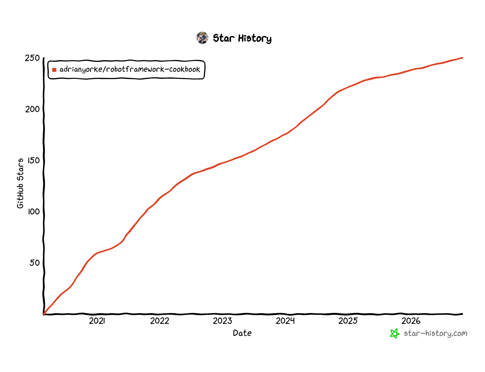

# <br>robotframework-cookbook

<!-- ALL-CONTRIBUTORS-BADGE:START - Do not remove or modify this section -->
[](#contributors-)
<!-- ALL-CONTRIBUTORS-BADGE:END -->
[](https://github.com/adrianyorke/robotframework-cookbook/actions)
[](https://opensource.org/licenses/MIT)
[](https://github.com/psf/black)
[](https://github.com/adrianyorke)


A curated list of delicious Robot Framework recipes that will help accelerate the development of test automation scripts, especially for beginner or intermediate level engineers.

If you need help writing Robot Framework scripts or wish to update older scripts to use newer syntax then you have come to the right place.  Here we will compile and maintain recipes of working Robot Framework scripts that can be used in your domain.

In the first part of the cookbook there are many simple recipes showing how to use builtin keywords and additional keywords from both internal and external Robot Framework libraries.  Towards the back of the cookbook there are complete case studies demonstrating whole projects and test automation solutions.

## Other useful resources
* [Robot Framework Organization](https://robotframework.org/)
* [Beginners Guide to Robot Framework](https://github.com/robotframework/BeginnersGuide)
* [Robot Framework Quick Start Guide](https://github.com/robotframework/QuickStartGuide/blob/master/QuickStart.rst)
* [Robot Framework User Guide](https://robotframework.org/robotframework/latest/RobotFrameworkUserGuide.html)
* [Robot Framework documentation](https://robotframework.org/robotframework/)
* [GitHub (Documentation, Source Code & Issue Tracker)](https://github.com/robotframework/robotframework)
* [Awesome Robot Framework](https://github.com/MarketSquare/awesome-robotframework)
* [Robot Framework - Learn the basics](https://dev.szabolcstoth.eu/robotframework-basics/)
* [Robot Framework Guides](https://docs.robotframework.org/docs)

## Star History


## Notes for contributors
Contributions from the wider community are most welcome!  Contributions can be either single recipes or whole case studies.

We welcome pull requests from both human and AI contributors.  AI generated pull requests are welcome, but AI slop is not, so please make sure you follow the instructions and test all changes locally before submitting.

We recommend using [Robotidy](https://robotidy.readthedocs.io/en/latest/) to help standardise the format of the Robot Framework code.

We also recommend using the [Robot Framework Robocop](https://github.com/MarketSquare/robotframework-robocop) static analysis tool to check your scripts are clean before submission.
Robocop can be installed using pip:
> $ python -m pip install -U robotframework-robocop

[Issues](https://github.com/adrianyorke/robotframework-cookbook/issues) are welcome and you can use them to post ideas for new recipes or report bugs and other observations for exisiting recipes. All contributions, human and AI, must be linked to a relevant [Issue](https://github.com/adrianyorke/robotframework-cookbook/issues).

For larger submissions simply clone this repository, create a feature branch (or work directly on master) and submit a pull request to merge your branch. If you are not comfortable with Git workflow then simply contact the maintainer of this project via email at [adrianyorke@gmail.com](mailto:adrianyorke@gmail.com) and I will help you publish your recipe or case study.

## Installation and Usage

Python and Robot Framework must be installed prior to using [Robot Framework Cookbook](https://github.com/adrianyorke/robotframework-cookbook). Download [Python](https://www.python.org/downloads/) and add to [PATH](https://docs.python.org/3/using/windows.html#the-full-installer) during installation, then, use a command-line interpreter of your choice and run the following to install Robot Framework:

> $ python -m pip install -U robotframework

You can check if the installation was succesful by running the following command:
> $ robot --version

After confirming Robot Framework installation was a success, clone the [Robot Framework Cookbook](https://github.com/adrianyorke/robotframework-cookbook) repository by running the following command:

> $ git clone https://github.com/adrianyorke/robotframework-cookbook.git

Once the repository has been cloned, you can install relevant libraries by navigating to the tests folder and running:

> $ python -m pip install -U -r ./tests/requirements-[version].txt

## Understanding the Format of a Robot Framework Test Suite (*.robot)

The recipes in this Cookbook currently dive straight into the use of keywords from various Robot Framework libraries.  Before making use of any of the recipes it is helpful to understand the basic format of a Robot Framework test suite.

A Robot Framework test suite is made up of one or more files that contain the following sections:

* `*** Settings ***` - configuration for the test suite, such as library imports, documentation and metadata.
* `*** Variables ***` - variables used by the test suite.
* `*** Test Cases ***` - the test cases that contain the keywords to execute.
* `*** Keywords ***` - reusable user keywords (optional).

The following example demonstrates the basic format using the content from [Recipe 1.1 - Hello World Logging](src/section_01/recipe011_hello_world_logging.robot):

```robot
*** Settings ***
Documentation    CONTEXT:
...              You want to output a text message or variable to the log generated by Robot Framework.
...              DISCUSSION:
...              Congratulations!  You have created your first Robot Framework script which outputs
...              a text message and a variable to the log and also the console.
...              This recipe only using keywords from BuiltIn standard library so there is no Library import.
Test Tags        py3.11    py3.12

*** Variables ***
${recipe}         Recipe 1.1 Hello World Logging
${level}          Beginner
${category}       Internal Library: BuiltIn
${name}           Alan Turing

*** Test Cases ***
Sending Ouput To Log and Console
    [Documentation]    Output variables & text messages to the log, console or both.
    Log Variables
    Log    Hello World!
    Log    Hello ${name}!    console=yes
    Log To Console    Hello World again, this time only output to the console.
```

### Metadata

The `*** Settings ***` section of a test suite can also be used to attach metadata and tags to the suite.  Metadata is specified using the syntax `name:value`:

```robot
*** Settings ***
Metadata    cookbook:robotframework-cookbook
...        recipe:Hello World Logging
```

For more information see the [Robot Framework User Guide](https://robotframework.org/robotframework/latest/RobotFrameworkUserGuide.html).

## Table of contents
1. Standard Library - [BuiltIn](https://robotframework.org/robotframework/latest/libraries/BuiltIn.html)
   * [Recipe 1.1 - Hello World Logging](src/section_01/recipe011_hello_world_logging.robot)<br>
   * [Recipe 1.2 - For Loop](src/section_01/recipe012_looping.robot)<br>
2. Standard Library - [Collections](https://robotframework.org/robotframework/latest/libraries/Collections.html)
   * [Recipe 2.1 - Explaining Variable Prefixes](src/section_02/recipe021_explaining_variable_prefixes.robot)<br>
   * [Recipe 2.2 - Handling Lists](src/section_02/recipe022_handling_lists.robot)<br>
   * [Recipe 2.3 - Handling Dictionaries](src/section_02/recipe023_handling_dictionaries.robot)<br>
3. Standard Library - [DateTime](https://robotframework.org/robotframework/latest/libraries/DateTime.html)
   * [Recipe 3.1 - Handling Dates](src/section_03/recipe031_handling_dates.robot)<br>
4. Standard Library - [OperatingSystem](https://robotframework.org/robotframework/latest/libraries/OperatingSystem.html)
   * [Recipe 4.1 - Working With File System](src/section_04/recipe041_working_with_file_system.robot)<br>
5. Standard Library - [Process](https://robotframework.org/robotframework/latest/libraries/Process.html)
   * [Recipe 5.1 - Working With Process Library](src/section_05/recipe051_working_with_process_library.robot)<br>
6. Standard Library - [Remote Library](https://robotframework.org/robotframework/latest/RobotFrameworkUserGuide.html#remote-library-interface)
   * [Recipe 6.1 - Working With Remote Library](src/section_06/recipe061_working_with_remote_library.robot)<br>
7. Standard Library - [String](https://robotframework.org/robotframework/latest/libraries/String.html)
   * [Recipe 7.1 - String Manipulation Examples](src/section_07/recipe071_string_manipulation_examples.robot)<br>
8. Working With Semi-Structured and Structured Data Files
   * [Recipe 8.1 - Working With JSON](src/section_08/recipe081_working_with_json.robot)<br>
   * [Recipe 8.2 - Working With YAML](src/section_08/recipe082_working_with_yaml.robot)<br>
   * [Recipe 8.3 - Working With CSV](src/section_08/recipe083_working_with_csv.robot)<br>
   * [Recipe 8.4 - Working With XML](src/section_08/recipe084_working_with_xml.robot)<br>
9. External Library - REST API
   * [Recipe 9.1 - Working With Requests Library](src/section_09/recipe091_working_with_requests_library.robot)<br>
   * [Recipe 9.2 - Working With RESTinstance Library](src/section_09/recipe092_working_with_rest_library.robot)<br>
   * [Recipe 9.3 - Working With Browser Library](src/section_09/recipe093_working_with_browser_library.robot)<br>
10. External Library - [Database Library](https://pypi.org/project/robotframework-databaselibrary/)<br>
    * [Recipe 10.1 - Working With Databases](src/section_10/recipe101_working_with_databases.robot)<br>
    * [Recipe 10.2 - Hacking Database View](src/section_10/recipe102_hacking_database_view.robot)<br>
11. External Library - [SSH](https://github.com/robotframework/SSHLibrary)
    * [Recipe 11.1 - Working With SSH](src/section_11/recipe111_working_with_ssh_library.robot)<br>
    * [Recipe 11.2 - Retrieve Output from SSH Run Command](src/section_11/recipe112_retrieve_output_file_of_ssh_run_command.robot)<br>
12. External Library - [Parallel executor for Robot Framework test cases (pabot)](https://github.com/mkorpela/pabot)
    * [Recipe 12.1 - Running Tests in Parallel](src/section_12/recipe121_running_tests_in_parallel.robot)<br>
13. External Library - [SeleniumLibrary](https://github.com/robotframework/seleniumlibrary) and [SeleniumTestability](https://github.com/rasjani/robotframework-seleniumtestability)
    * [Recipe 13.1 - SeleniumLibrary & SeleniumTestability setup](src/section_13/recipe131_selenium_setup.robot)<br>
14. External Library - [AWSLibrary - for interacting with Amazon Web Services (AWS) Cloud Computing Services](https://github.com/teaglebuilt/robotframework-aws)
    * [Recipe 14.1 - AWS Simple Storage Service (S3)](src/section_14/recipe141_aws_simple_storage_service.robot)<br>
15. External Library - [Robot Framework Browser library powered by Playwright.](https://github.com/MarketSquare/robotframework-browser)
    * [Recipe 15.1 - Working With Browser Contexts](src/section_15/recipe151_working_with_browser_contexts.robot)<br>
16. Robot Framework - Exploring New Syntax Introduced by Significant Releases
    * [Recipe 16.1 - Robot Framework 4 - New Syntax](src/section_16/recipe161_rf4_new_syntax.robot)<br>
    * [Recipe 16.2 - Robot Framework 5 - New Syntax](src/section_16/recipe162_rf5_new_syntax.robot)<br>
    * [Recipe 16.3 - Robot Framework 6 - New Syntax](src/section_16/recipe163_rf6_new_syntax.robot)<br>
    * [Recipe 16.4 - Robot Framework 7 - New Syntax](src/section_16/recipe164_rf7_new_syntax.robot)<br>
17. External Library - [Faker](https://github.com/MarketSquare/robotframework-faker)
    * [Recipe 17.1 - Faker Basic Tests](src/section_17/recipe171_faker_basic_tests.robot)<br>
18. Case Studies
    * [Case Study 01 - Regression Testing Gerald Ford International Airport (GFIA) Parking Lot Calculation Tool](src/section_99/casestudy_01/README.md)<br>
    * [Case Study 02 - Transcoding video library to a contemporary format suitable for all play back devices, e.g. mp4 or mkv](src/section_99/casestudy_02/README.md)<br>

## Contributors ✨

Thanks goes to these wonderful people ([emoji key](https://allcontributors.org/docs/en/emoji-key)):

<!-- ALL-CONTRIBUTORS-LIST:START - Do not remove or modify this section -->
<!-- prettier-ignore-start -->
<!-- markdownlint-disable -->
<table>
  <tbody>
    <tr>
      <td align="center" valign="top" width="14.28%"><a href="https://github.com/adrianyorke"><br /><sub><b>Adrian Yorke</b></sub></a><br /><a href="https://github.com/adrianyorke/robotframework-cookbook/commits?author=adrianyorke" title="Code">💻</a> <a href="https://github.com/adrianyorke/robotframework-cookbook/commits?author=adrianyorke" title="Documentation">📖</a> <a href="#maintenance-adrianyorke" title="Maintenance">🚧</a> <a href="https://github.com/adrianyorke/robotframework-cookbook/pulls?q=is%3Apr+reviewed-by%3Aadrianyorke" title="Reviewed Pull Requests">👀</a></td>
      <td align="center" valign="top" width="14.28%"><a href="http://www.tompurl.com"><br /><sub><b>Tom Purl</b></sub></a><br /><a href="https://github.com/adrianyorke/robotframework-cookbook/commits?author=tompurl" title="Code">💻</a> <a href="https://github.com/adrianyorke/robotframework-cookbook/commits?author=tompurl" title="Documentation">📖</a></td>
      <td align="center" valign="top" width="14.28%"><a href="http://szabolcstoth.eu"><br /><sub><b>Szabolcs Tóth</b></sub></a><br /><a href="https://github.com/adrianyorke/robotframework-cookbook/commits?author=szabolcstoth" title="Code">💻</a> <a href="https://github.com/adrianyorke/robotframework-cookbook/commits?author=szabolcstoth" title="Documentation">📖</a></td>
      <td align="center" valign="top" width="14.28%"><a href="https://rasjani.github.io"><br /><sub><b>Jani Mikkonen</b></sub></a><br /><a href="https://github.com/adrianyorke/robotframework-cookbook/commits?author=rasjani" title="Code">💻</a> <a href="https://github.com/adrianyorke/robotframework-cookbook/commits?author=rasjani" title="Documentation">📖</a></td>
      <td align="center" valign="top" width="14.28%"><a href="https://github.com/bhirsz"><br /><sub><b>Bartłomiej Hirsz</b></sub></a><br /><a href="https://github.com/adrianyorke/robotframework-cookbook/commits?author=bhirsz" title="Code">💻</a> <a href="https://github.com/adrianyorke/robotframework-cookbook/commits?author=bhirsz" title="Documentation">📖</a> <a href="#maintenance-bhirsz" title="Maintenance">🚧</a> <a href="https://github.com/adrianyorke/robotframework-cookbook/pulls?q=is%3Apr+reviewed-by%3Abhirsz" title="Reviewed Pull Requests">👀</a></td>
      <td align="center" valign="top" width="14.28%"><a href="https://github.com/tuxmux28"><br /><sub><b>Christoph</b></sub></a><br /><a href="https://github.com/adrianyorke/robotframework-cookbook/commits?author=tuxmux28" title="Code">💻</a> <a href="https://github.com/adrianyorke/robotframework-cookbook/commits?author=tuxmux28" title="Documentation">📖</a></td>
      <td align="center" valign="top" width="14.28%"><a href="https://github.com/mkorpela"><br /><sub><b>Mikko Korpela</b></sub></a><br /><a href="https://github.com/adrianyorke/robotframework-cookbook/commits?author=mkorpela" title="Code">💻</a> <a href="https://github.com/adrianyorke/robotframework-cookbook/commits?author=mkorpela" title="Documentation">📖</a></td>
    </tr>
    <tr>
      <td align="center" valign="top" width="14.28%"><a href="https://github.com/ericbjones"><br /><sub><b>ericbjones</b></sub></a><br /><a href="#design-ericbjones" title="Design">🎨</a> <a href="https://github.com/adrianyorke/robotframework-cookbook/commits?author=ericbjones" title="Code">💻</a> <a href="https://github.com/adrianyorke/robotframework-cookbook/commits?author=ericbjones" title="Documentation">📖</a></td>
      <td align="center" valign="top" width="14.28%"><a href="https://emnaayadi.wordpress.com/"><br /><sub><b>Emna Ayadi</b></sub></a><br /><a href="#userTesting-emna24" title="User Testing">📓</a> <a href="https://github.com/adrianyorke/robotframework-cookbook/commits?author=emna24" title="Code">💻</a></td>
      <td align="center" valign="top" width="14.28%"><a href="https://medium.com/@joonasvenlinen"><br /><sub><b>Joonas Venäläinen</b></sub></a><br /><a href="https://github.com/adrianyorke/robotframework-cookbook/commits?author=joonvena" title="Code">💻</a></td>
      <td align="center" valign="top" width="14.28%"><a href="https://github.com/olakowalczyk"><br /><sub><b>Aleksandra Kowalczyk</b></sub></a><br /><a href="https://github.com/adrianyorke/robotframework-cookbook/commits?author=olakowalczyk" title="Code">💻</a></td>
      <td align="center" valign="top" width="14.28%"><a href="https://github.com/kiblik1"><br /><sub><b>Martin Škopek</b></sub></a><br /><a href="https://github.com/adrianyorke/robotframework-cookbook/commits?author=kiblik1" title="Code">💻</a></td>
      <td align="center" valign="top" width="14.28%"><a href="https://github.com/sarafurd"><br /><sub><b>sarafurd</b></sub></a><br /><a href="https://github.com/adrianyorke/robotframework-cookbook/commits?author=sarafurd" title="Documentation">📖</a> <a href="#maintenance-sarafurd" title="Maintenance">🚧</a></td>
      <td align="center" valign="top" width="14.28%"><a href="https://jepoy92.github.io/webdev-portfolio/"><br /><sub><b>Jeff Choi</b></sub></a><br /><a href="https://github.com/adrianyorke/robotframework-cookbook/commits?author=jepoy92" title="Documentation">📖</a> <a href="#maintenance-jepoy92" title="Maintenance">🚧</a></td>
    </tr>
    <tr>
      <td align="center" valign="top" width="14.28%"><a href="https://github.com/ChinoUkaegbu"><br /><sub><b>ChinoUkaegbu</b></sub></a><br /><a href="https://github.com/adrianyorke/robotframework-cookbook/commits?author=ChinoUkaegbu" title="Code">💻</a></td>
      <td align="center" valign="top" width="14.28%"><a href="https://github.com/dajiaohuang"><br /><sub><b>Wu Shuwen</b></sub></a><br /><a href="#maintenance-dajiaohuang" title="Maintenance">🚧</a></td>
    </tr>
  </tbody>
</table>

<!-- markdownlint-restore -->
<!-- prettier-ignore-end -->

<!-- ALL-CONTRIBUTORS-LIST:END -->

This project follows the [all-contributors](https://github.com/all-contributors/all-contributors) specification. Contributions of any kind welcome!
